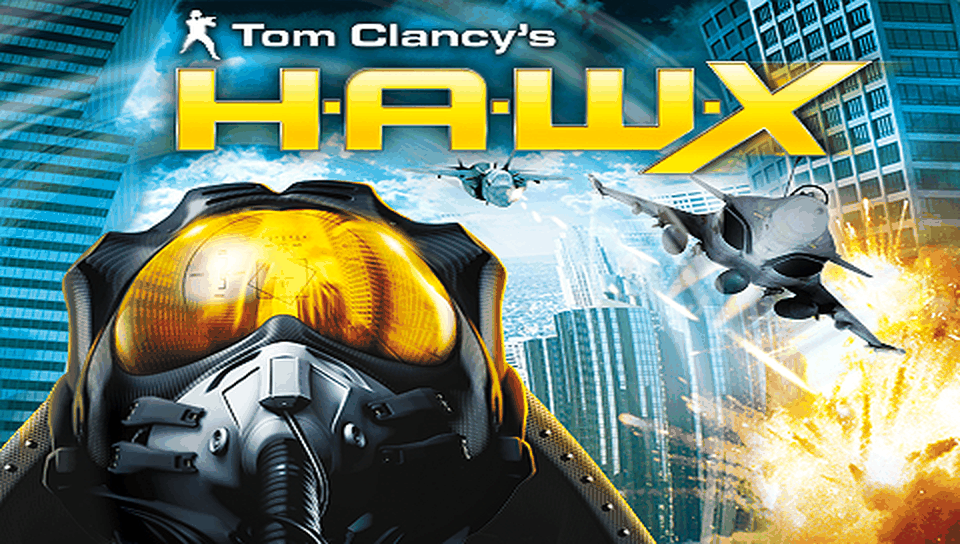

<h1 align="center">
  <br>
  Tom Clancy's H.A.W.X · PS Vita Port
</h1>

<p align="center">
  <a href="#-status--playability">Status & Playability</a> •
  <a href="#setup-instructions-for-players">How to install</a> •
  <a href="#controls">Controls</a> •
  <a href="#known-issues">Known Issues</a> •
  <a href="#build-instructions-for-developers">How to compile</a> •
  <a href="#credits--acknowledgments">Credits</a>
</p>

An unofficial, native **iOS-to-PS Vita wrapper port** of *Tom Clancy's H.A.W.X* (iPhone version by **Gameloft**, 2009). There is no `.so` here: this port ships its own **Mach-O loader** that maps the official armv6 iOS executable (`Hawx`, from the 1.1.3 IPA) into PS Vita RAM and replaces the Apple frameworks it uses (Foundation, UIKit, CoreFoundation, CoreGraphics, AudioToolbox, OpenAL, OpenGL ES) with native implementations on top of **vitaGL**, **openal-soft** and the Vita system libraries.

---

## 🎮 Status & Playability

**Status: WIP (v1.0 preview)**

On physical PlayStation Vita hardware the game boots, loads its data, reaches the title screen and the Flash (gameswf) menus, and creates a pilot profile. Missions have not been played on console yet.

- [x] **Mach-O loader**: loads the armv6 executable at a fixed base (`MACHO_SLIDE = 0x98000000`), applies **77,629** rebase words, resolves **8,267** import slots (0 unimplemented imports), runs the **191** global constructors and enters `UIApplicationMain`. *Verified on console.*
- [x] **Graphics**: GLES 1.x → **vitaGL** (`SOFTFP_ABI=1`). The game runs as a 480×320 landscape iPhone and is shown on the 960×544 screen at **816×544 with side bars** (aspect kept). Title screen and menus render correctly. *Verified on console.*
- [x] **Touch**: the front touchscreen acts as the iPhone screen, with real per-view hit-testing. *Verified on console.*
- [x] **Text input**: the profile name is typed with the Vita on-screen keyboard (`sceImeDialog`). *Verified on console.*
- [x] **Saves**: iOS `Documents/` is redirected to `ux0:data/hawx/Documents/` (`Settings`, `Profiles`). *Verified on console.*
- [x] **Tilt controls**: the left stick simulates the iPhone accelerometer (the plane is flown by tilting).
- [ ] **Audio**: OpenAL sound effects and Ogg music are wired up, but not confirmed on console yet.
- [ ] **In-game (missions)**: not reached on console yet.
- [ ] **Trophies**: not implemented.

---

## Disclaimer

**Tom Clancy's H.A.W.X** is a registered trademark of **Ubisoft Entertainment**. The iPhone version was developed and published by **Gameloft**. The work presented in this repository is unofficial and is not produced, endorsed, or sanctioned by Ubisoft, Gameloft or any affiliated entities.

This software does NOT contain original game code, binaries, copyrighted graphics, or game assets. The authors do not promote or condone piracy in any way. To play, you must provide your own legally obtained, **decrypted** copy of the iOS `.ipa`.

---

## Setup Instructions (For Players)

1. **CFW & Plugins**: PS Vita on Custom Firmware (**Enso 3.60 / 3.65** recommended) with `kubridge` under `*KERNEL` in `ur0:tai/config.txt`:
   ```ini
   *KERNEL
   ur0:tai/kubridge.skprx
   ```
2. **Shader Compiler**: `libshacccg.suprx` must be in `ur0:data/` (extract it with **ShaRKBR33D**).
3. **Game Files**: a decrypted **Tom Clancy's H.A.W.X 1.1.3** iOS `.ipa` (FairPlay `cryptid 0`, `CFBundleVersion 1.1.3`). Open it as a ZIP and extract `Payload/Hawx.app/`. No other version works with the provided `rebase.bin` / `binds.bin`.
4. **Copy to the Vita** (`ux0:data/hawx/`):
   ```
   ux0:data/hawx/
     game_app/      the contents of Hawx.app from the IPA, untouched (renamed to game_app)
     rebase.bin     from the release (or generated with tools/stage_data.sh)
     binds.bin      from the release (or generated with tools/stage_data.sh)
     nib.txt        from the release (MainWindow.nib, precompiled)
     controls.txt   optional — button → touch mapping (see Controls)
     Documents/     created automatically — your profiles and settings
     logs/          created automatically — hawx_001.log … one per run
   ```
5. **Install VPK**: install `hawx.vpk` with VitaShell.

---

## Controls

Physical buttons are translated into touches at fixed points of the screen. The points are set in `ux0:data/hawx/controls.txt` (coordinates on the 480×320 game screen, up to 6 lines, editable without recompiling). Without that file only touch and the left stick work.

| Input | Action | Status |
| :---: | :--- | :---: |
| **Front Touchscreen** | iPhone touch screen (menus, HUD) | ✅ Working |
| **Left Stick** | Tilt (simulated accelerometer: roll / pitch) | ⚠️ Not tested in flight |
| **Cross (✖)** | Touch at 430,270 (example `controls.txt`) | ⚠️ Not tested in flight |
| **Circle (●)** | Touch at 50,270 (example `controls.txt`) | ⚠️ Not tested in flight |
| **Square (◼)** | Touch at 430,50 (example `controls.txt`) | ⚠️ Not tested in flight |
| **Start** | Touch at 240,160 (example `controls.txt`) | ⚠️ Not tested in flight |
| **Select + Start (hold 2 s)** | Cycle the picture rotation (saved to `rotation.txt`) | ✅ Working |

> [!TIP]
> An example mapping is in [`tools/controls.example.txt`](tools/controls.example.txt). Each line is `BUTTON X Y`.

---

## Known Issues

- **Early build**: only boot, title screen, menus and profile creation have been tested on hardware.
- **Menu "next" button**: in the last console run the button highlighted but did not act after creating a profile. A fix (release keeps the last touch point, like iOS) is included in this build but is not verified on console yet.
- **OpenAL log warning**: the log shows `Error creating device/context` even though `alcOpenDevice` returns a device.
- **Side bars**: the picture is not stretched to 16:9.
- **Online features disabled**: Gameloft online services and Game Center are not available.
- **Crash dumps** are written by the system to `ux0:data/` (not to the game folder).

---

## Build Instructions (For Developers)

### Prerequisites

- [VitaSDK](https://vitasdk.org/) (`$VITASDK`, softfp) with `vitaGL` (vendored), `vitashark`, `openal-soft`, `libvorbis`/`libogg`, `freetype`, `libpng`, `zlib`, `bzip2` and `mathneon`.
- CMake 3.14+, Python 3 (for the tools).
- The decrypted `Hawx.app` folder, linked as `game_app` in the repo root (never committed).

### Compilation Commands

```bash
git clone https://github.com/MetalSyntax/HAWX-vita.git
cd HAWX-vita
ln -s /path/to/Payload/Hawx.app game_app

# Stage the console data (copies the .app, generates rebase.bin / binds.bin / nib.txt)
tools/stage_data.sh

# Build eboot.bin / hawx.vpk
cmake -S . -B build
cmake --build build
```

### Deploy & Debug (over VitaShell FTP)

```bash
python3 -I tools/deploy_data.py          # upload ux0_data/hawx/ (rebase.bin, binds.bin and nib.txt always re-sent)
python3 -I tools/deploy_data.py --logs   # fetch logs and crash dumps into ./logs/
```

A crash PC in `0x98xxxxxx` minus `0x98000000` is the address in the Mach-O: look it up with `python3 -I tools/annotate.py`. A data address below `0x02000000` means a missing rebase (see `report.txt`). Architecture and progress notes: [`PORTING_PLAN.md`](PORTING_PLAN.md) and [`port_progress.md`](port_progress.md).

---

## ☕ Support My Work

This project is **free** and will stay free. If you enjoy it, a tip from **$1** helps me keep porting games to the PS Vita:

<p align="center">
  <a href="https://ko-fi.com/metalsyntax"></a>
</p>

- **Ko-fi:** [ko-fi.com/metalsyntax](https://ko-fi.com/metalsyntax)
- **PayPal:** [paypal.me/MetalSyntax](https://paypal.me/MetalSyntax)
- **Bitcoin (BTC):** `133HdCsaWxdjTfmwpgGVykByhNBV338uRc`

**Ko-fi supporters get:**
- **Early access** to new ports before their public release (test builds of upcoming projects).
- **Data preparation scripts and step-by-step guides** to set up your own game files for each new port.
- A say in which games I port next.

> Game files are never distributed. You always need your own legally obtained copy of the game.

---

## Credits & Acknowledgments

- **Tom Clancy's H.A.W.X** is intellectual property of **Ubisoft Entertainment**; the iPhone version was developed by **Gameloft** on top of the Irrlicht engine and gameswf.
- **vitaGL** graphics library by [Rinnegatamante](https://github.com/Rinnegatamante/vitaGL).
- **kubridge** plugin by [Bythos](https://github.com/bythos14/kubridge).
- **openal-soft**, **FreeType**, **libpng** and **zlib** projects.
- The **iOS Mach-O loader** is based on [`ios-loader-boilerplate`](https://github.com/MetalSyntax/ios-loader-boilerplate) and [`Inotia2-vita`](https://github.com/MetalSyntax/Inotia2-vita); the shared iOS runtime is kept in [`Ferrari-GT-Evolution-vita`](https://github.com/MetalSyntax/Ferrari-GT-Evolution-vita).
- Special thanks to the PS Vita homebrew and porting community.
